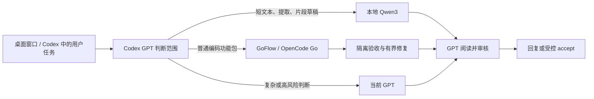

# Local AI × GoFlow

**Local Qwen3 for simple tasks, OpenCode Go for ordinary coding packages, and Codex GPT for judgment and review.** Windows alpha · MIT.

本地 Qwen3 处理简单短任务，Go 编写普通功能包及测试，Codex GPT 判断范围、核对结果并最终审核。安装后将默认分工写入用户级 `AGENTS.md`，供本机各项目和后续新聊天使用，无需每次提醒。用户的明确选择、保存的模式和项目规则继续优先。

**v0.4.0** 将桌面聊天窗口接入官方 Codex App Server：在同一个窗口提出需求，由现有 ChatGPT 登录的 Codex GPT 协调本地 Qwen3、OpenCode Go 和最终审核。窗口提供项目注册、绑定项目的会话、执行进度、审批及补充问题，并显示从实际 MCP 调用提取的任务与审核收据。变更记录见 [CHANGELOG.md](CHANGELOG.md)。



自动分工由真实的 Codex 主智能体通过技能和受控工具完成。桌面窗口通过 [官方 Codex App Server](https://learn.chatgpt.com/docs/app-server) 的本地 stdio 协议管理会话和回合，复用 Codex 自己维护的现有 ChatGPT 登录；本项目不提取或搬运凭据。本地任务使用本项目的 worker；提交 Go 任务、恢复队列和最终 accept 继续使用独立的 GoFlow。窗口打开期间有本地服务，没有无人值守的模型重试或调度循环。

## 前置条件

- Windows、Node.js **24+**、已用 ChatGPT 登录且支持 `app-server` 的原生 Codex 可执行文件。仅有 `codex.ps1` 或 `codex.cmd` 包装而找不到原生程序时，不会把任意脚本当作后台命令执行。
- 独立安装的 [Ollama](https://github.com/ollama/ollama)，本机固定 `127.0.0.1:11434` 上运行 `qwen3:8b`。模型必须事先安装；本仓库不分发模型或运行时二进制。
- 独立安装并配置的 [GoFlow](https://github.com/DrEli7/GoFlow)，其受信用户级入口位于 `~/.codex/goflow/scripts/client.mjs`。由 GoFlow 维护登录、真实 `opencode-go/*` 模型目录、订阅/余额保护、官方额度、隔离、测试、修复预算与审核。
- 使用标准 `~/.codex` 用户目录。公开 alpha 尚不支持自定义 `CODEX_HOME`，也不自动启用已关闭的插件或权限。

本仓库不会登录账户、收集 key、更改费用保护或打开余额回退。新安装者必须自行按 GoFlow 的说明完成个人授权与费用确认。

桌面协调器优先查找 `%LOCALAPPDATA%/OpenAI/Codex/bin/*/codex.exe`，再查找 PATH 中的原生 Codex 程序。需要指定其他可信安装位置时，可在启动窗口的本机 PowerShell 环境中设置 `$env:LOCAL_AI_CODEX_EXE = 'C:\绝对路径\codex.exe'`。该配置必须是已存在的原生可执行文件绝对路径；浏览器不提供命令、启动参数或 provider 配置入口。未登录 ChatGPT、使用 API key 或意外的其他 provider 时，协调器明确阻止执行，不自动切换付费 API。

## 安装

在 PowerShell 中执行：

```powershell
git clone https://github.com/DrEli7/local-ai-goflow.git
Set-Location local-ai-goflow
npm ci --ignore-scripts --registry=https://registry.npmjs.org
powershell -NoProfile -File .\scripts\install.ps1 -CheckOnly
powershell -NoProfile -File .\scripts\install.ps1
```

安装器在用户目录建立自己的插件包装、生成本机绝对 MCP 启动路径、添加 `goflow-local` 个人 marketplace 条目，并更新用户 `AGENTS.md` 中唯一的 `LOCAL_AI_GOFLOW` 标记块。其他 GoFlow 规则和 marketplace 条目保留。目标目录已存在且不属于本安装器、marketplace 冲突或规则标记不完整时会拒绝。

保留此仓库目录和 `node_modules`；安装包装引用这份源码，移动目录后需要重新运行安装器。仓库目录须对当前用户可写，用于 `state` 元数据。安装不下载或启动模型，不修改 Windows 自启。公开版使用事先运行的 Ollama；可在另一个终端执行 `ollama serve`（服务已经运行时无需重复启动）。准备模型时使用官方 Ollama 流程，例如 `ollama pull qwen3:8b`，网络或存储条件需自行满足。

## 一个窗口使用自动分工

确认 Codex 已完成 ChatGPT 登录、GoFlow 已按其说明配置，Ollama 已在本机运行并已安装 `qwen3:8b`，在仓库目录执行：

```powershell
powershell -NoProfile -File .\scripts\start-chat.ps1 -CheckOnly
powershell -NoProfile -File .\scripts\start-chat.ps1
powershell -NoProfile -File .\scripts\install-chat-shortcut.ps1 -CheckOnly
powershell -NoProfile -File .\scripts\install-chat-shortcut.ps1
```

启动器以隐藏进程运行本包聊天服务，再以可见的 Edge/Chrome 应用窗口打开聊天界面。应用窗口使用本包 `state/chat/browser-profile/` 的独立本机配置，重复打开会复用该配置，不修改日常浏览器的设置或扩展。系统策略统一安装的扩展仍由浏览器管理。启动参数包含固定应用地址、独立 `--user-data-dir`、`--no-first-run` 和 `--no-default-browser-check`。浏览器不在常见安装位置时，会明确提示并使用系统浏览器的原有配置，此回退不提供独立应用配置。聊天页面固定为 `http://127.0.0.1:18441/`；仅启动服务可加 `-NoWindow`。启动器检查服务的应用标识、版本和当前服务器文件 SHA256，匹配时复用；端口被其他程序或不同版本占用时拒绝启动，不终止占用者。`-CheckOnly` 只做预检，不创建浏览器配置、启动服务或窗口。

桌面入口默认名为“本地 AI - Qwen3”。安装器不会覆盖不属于本应用的同名快捷方式；可用 `-ShortcutName 'Qwen3 聊天'` 选择另一个名字。更新自己创建的入口前，会把旧入口备份到忽略提交的 `state/chat/shortcut-backups/`。如需运行个人自建的启动包装，可显式提供 `-LauncherPath`，值必须是已存在的可信 `.ps1` 绝对路径；该脚本会在点击入口时执行，请先阅读其内容。公开启动器不会自动猜测或启动个人的 Ollama 包装。

新聊天默认使用自动分工。直接输入摘要、改写等有明确输入的简单任务，Codex 按既有规则交本地 Qwen3 生成候选并审核；普通编码功能包交 Go 实现和测试，GPT 核对实际代码、需求和测试后，再走 GoFlow 的受控 accept。复杂或高风险部分由 GPT 判断并拆出适合 Go 的独立功能包。无需另开 Codex 窗口重复提出需求。

首次使用可直接采用本包独立的 `state/chat/workspace/` 工作目录；需要修改已有项目时，先在聊天窗口登记其现存绝对目录，再为该项目新建聊天。每个会话绑定一个项目，创建后不能切换目录；换项目请新建会话。协调器只恢复本服务登记的 Codex 线程，页面不能提供任意线程 ID 接管其他聊天。

进度区展示实际任务状态，收据从对应 MCP 调用结果校验候选 hash 与审核决定后，显示执行来源、任务 ID 以及审核或排队状态。完整测试与候选证据仍由原 GoFlow 保存。模型回复里写“已完成”或“已审核”不会单独生成验收收据。额度、登录或服务阻塞会显示真实状态；只有 GoFlow 返回队列任务 ID 时才显示已排队。继续执行前先核实原任务和状态，保持同一任务 ID、已有修复次数和审核证据，不以新任务绕过保护。

需要命令或文件审批、补充业务信息时，问题直接显示在这个聊天窗口。Codex 对 GoFlow 应用补丁发出的原生工具确认也在这里显示，仅接受受信 Go/local 服务的空表单单次确认，不收集凭据或任意表单字段。审批仅支持本次决定，不创建会话级白名单；不支持的审批类型会拒绝并中断，额外权限及网络专用审批暂未接入。协调器继承现有 Codex 权限、沙箱和审批审核者，不修改全局设置，不绕过自动审核拒绝。项目目录用于确定工作上下文，**目录绑定本身不是操作系统隔离**；真实文件、网络权限以 Codex 生效配置为准。

“停止”会请求中断当前 Codex 回合；它不能撤销已完成的文件修改、已提交或已发送的模型请求。需要撤销变更时，先核对项目差异再处理。原直连本地模型的 `/api/chat` 接口保留兼容，默认聊天界面使用新的协调流程。

聊天历史使用 v2 格式保存在浏览器本机存储。正常应用窗口使用上述独立浏览器配置；系统浏览器回退使用该浏览器的原有配置。Codex 持久线程保存在其自己的本机状态中；`state/chat/coordinator.json` 仅登记会话映射和项目路径，不保存对话正文。界面删除或清空本机显示记录、卸载插件不会自动删除 Codex 的持久线程。运行状态日志位于 `state/chat/`，不写入对话正文。

**本地窗口不等于全离线。** 实际用户输入和必要的所选代码会按分工交给 Codex ChatGPT 或 OpenCode Go；Qwen3 的本地任务仍只发往本机 Ollama。GPT 每次协调和审核仍消耗当前 ChatGPT/Codex 订阅；本项目不承诺可量化的额度节省比例。

关闭窗口后，聊天服务约 10 分钟空闲时自动退出。可手工停止本包服务：

```powershell
powershell -NoProfile -File .\scripts\stop-chat.ps1 -CheckOnly
powershell -NoProfile -File .\scripts\stop-chat.ps1
```

停止器只处理健康标识、版本、服务器文件 hash、PID 和 Node 路径均与本包匹配的进程，不停止 Ollama。若启动时显式传入 `-NodeExe`，停止时也应提供同一个绝对 Node 路径。升级前先停止本包聊天服务，再更新源码；源码 hash 已变化时，停止器会拒绝按新源码认领旧进程。

## 在 Codex 中使用默认分工

在新聊天中开始使用。当前聊天尚未刷新工具目录时，可以使用同一插件的受限客户端；它仍检查用户和项目的插件/工具禁用与审批，遇到需原生审批的设置会拒绝替代执行。

```powershell
$localClient = Join-Path $env:USERPROFILE '.codex\plugins\local-ai-goflow\client.mjs'
'{}' | node $localClient local_ai_status
$task = @{
    projectDirectory = (Get-Location).Path
    kind = 'summarize'
    text = '合成示例：周三完成文档，周五演示。'
    risk = 'low'
}
$task | ConvertTo-Json -Compress | node $localClient local_ai_task
```

返回 `local_completed_review_required` 后，主智能体须阅读实际 `output`，核对输入，并用该 `taskId`、`candidateHash` 调用 `local_ai_review`；格式通过不是审核通过。

有字数限制时，主智能体应使用 `outputMetrics` 中对应字段的机器计数。`unicodeCodePoints` 是 Unicode code point 数，`utf16CodeUnits` 是 JavaScript 字符串长度；两者均含标点、空格、换行，emoji 下可能不同，也不等于可视字形数量。默认中文摘要可引用 `unicodeCodePoints`，用户指定其他计数规则时按指定规则核实。统计不会代替内容审核或改变候选 hash，历史请求与审核也不会被重写。

## 工具与默认分工

| 工具 | 用途 |
| --- | --- |
| `local_ai_status` | 查看本地服务、模型及指定项目的保存模式/GoFlow 可用性 |
| `local_ai_task` | 短摘要、改写、翻译、分类、字段提取、代码解释、短代码草稿 |
| `local_ai_review` | 为确切任务与候选 hash 记录 GPT 接受或拒绝；不应用代码 |
| `local_ai_metrics` | 读取真实请求、重试、失败、耗时和审核的元数据 |
| `local_ai_goflow_plan` | 通过受限 GoFlow status/usage/route 生成交接计划；不调用云模型 |

普通项目修改和完整测试交 Go；复杂或高风险父任务由 GPT 负责关键判断，并拆出独立普通包路由。桥接计划保留已知 `executionBackend` 和 `splitRequired`，仍不把缓存可用性当作执行许可。Go 不可用时保留原 GoFlow 返回的真实队列任务，不假称已排队，也不自动换成其他付费 provider。

GoFlow 提交时，`files` 只包含已存在、明确选择的输入文件。现有可编辑文件同时列入 `files` 和 `editableFiles`；待新建文件只列入 `editableFiles`，不要创建空占位。完全新建且无需已有输入的功能包可使用以下文件声明，其他提交参数仍按原 GoFlow schema 提供：

```json
{"files": [], "editableFiles": ["tags.mjs", "tags.test.mjs"]}
```

Go 编写实现和完整测试，GPT 在隔离验收后阅读实际结果再批准应用。公开插件的交接计划只查看和描述路由，不替代原 GoFlow 的提交、快照校验或批准。

用户可说“强制 GPT”“强制 Go”“关闭自动委派”“恢复自动模式”。全局规则、插件技能与实际保存模式一起决定执行；本插件不擅自更改模式。GPT 自身仍使用当前 ChatGPT/Codex 订阅。

## 边界与数据

- 本地 worker 固定本机 HTTP 回环和 `qwen3:8b`，拒绝远程模型别名与重定向，不继承代理；桌面协调使用官方 Codex App Server 和现有 ChatGPT 登录。
- 本地 worker 仅接收主智能体明确选择的无凭据短文本：正文 2400 字符、额外指令 400 字符，输入总量与队列有界。桌面聊天输入和所选项目内容另按实际路由交给 Codex 或 Go。
- 本地 worker 默认 context 4096、输出至多 768 tokens、关闭 thinking、单进程串行队列，每任务最多两次生成。多进程不能被当作全机并发限额。
- 本地模型没有 shell、文件读取、任意 URL、程序选择或补丁应用工具。
- 候选按严格 schema、完整结束标记和 hash 处理；代码执行与应用继续需要主智能体判断、适当验收与 GoFlow accept。
- `state/events.jsonl` 仅记任务类型、hash、实际请求/token/耗时与审核元数据，正文、输出和审核文本不写历史。`state/` 已被 Git 忽略；客户端返回的草稿仍由当前聊天处理。
- GoFlow 的状态和路由输出经过字段过滤，原账户配置、私有绑定、凭据、路径、账单及错误原文不随交接计划返回。
- 浏览器历史、协调器登记、本地 worker 元数据和 Codex 持久线程是不同的数据存储。`state/` 均忽略提交，发布源码时不包含个人聊天、项目路径、账户证据或运行日志。
- 本地需要 GPU/内存/电力，协调与审核仍有订阅消耗；不把 token 占比换算成费用或节省百分比。

## 验证与贡献

```powershell
npm test
```

测试使用 Node 内置 runner，覆盖结构化输出、失败与审核、保存模式、项目配置/禁用/审批、MCP 协议、固定 GoFlow 调用、额度视图及交接元信息；统一窗口增加官方会话协议、受限事件和收据、会话绑定、审批及停止路径的回归验证。离线测试不调用模型，不能代替本机现有登录、GoFlow 和模型环境的集成验证。

0.4.0 已在配置完成的本机从统一窗口实测：仅输入会议摘要需求，自动调用 Qwen3 并由 GPT 记录审核收据；另开聊天选择独立项目，仅输入 JavaScript 函数及测试需求，自动交给 Go。验收期间修正了原生 MCP 工具确认的窗口兼容问题，沿用同一 Go 任务；GPT 的具体负面审核带回一次修复，最终 13 项测试通过并受控应用，窗口显示真实 `accepted` 收据。192 项离线回归通过。这里的两次窗口确认用于验收已有原生权限流程，没有开启自动批准或调整用户权限；不能据此承诺所有任务无确认或推算额度节省。

较早的 Codex 插件部署曾完成“Qwen3 整理需求 → Go 实现/修复 → 14 项验收 → GPT accept”。另一次跨项目的真实新 Codex 聊天只收到合成会议纪要和标签工具业务要求，没有分工提醒：自动调用 Qwen3 整理摘要，经 GPT 审核后保存；Go 编写标签函数及测试，一次修复后 **18/18 测试通过**，由 GPT 阅读代码与日志并批准应用，落盘文件与已测试候选 hash 一致。这些历史记录不是新版独立窗口的端到端测试，不能据此推算费用节约。个人原始日志与账户证据不发布。

依赖通过 lockfile 固定并从官方 npm registry 获取；安装使用 `--ignore-scripts`。依赖漏洞状态随时间变化。提交前请运行测试，保持凭据和现场日志不入库。安全问题请勿附带真实 key、认证配置或个人日志。

## 禁用与卸载

在 Codex 插件设置中禁用 **Local AI x GoFlow**，或执行：

```powershell
codex plugin remove local-ai-goflow@goflow-local
```

要完全撤销此默认偏好，只移除用户 `AGENTS.md` 中 `LOCAL_AI_GOFLOW BEGIN/END` 之间的本插件块，以及个人 marketplace 中本插件的唯一条目。保留 GoFlow 的其他规则、配置和模型。停用 Ollama 模型可自行使用官方 `ollama stop qwen3:8b`。

## License

[MIT](LICENSE)。项目独立维护，与 OpenAI、OpenCode、Ollama 或 Qwen 没有隶属关系。运行依赖和模型适用各自许可；本仓库不重新分发它们。
