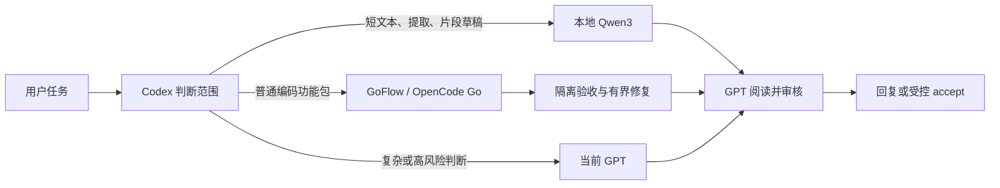

# Local AI × GoFlow

**Local Qwen3 for simple tasks, OpenCode Go for ordinary coding packages, and Codex GPT for judgment and review.** Windows alpha · MIT.

本地 Qwen3 处理简单短任务，Go 编写普通功能包及测试，Codex GPT 判断范围、核对结果并最终审核。安装后将默认分工写入用户级 `AGENTS.md`，供本机各项目和后续新聊天使用，无需每次提醒。用户的明确选择、保存的模式和项目规则继续优先。



自动分工由 Codex 主智能体通过技能和受控工具完成。本项目自身提供本地任务 worker 与只读 GoFlow 交接计划；提交 Go 任务、恢复队列和最终 accept 继续使用独立的 GoFlow。没有常驻调度循环。

## 前置条件

- Windows、Node.js **24+**、可用的 Codex CLI/桌面本地执行环境。
- 独立安装的 [Ollama](https://github.com/ollama/ollama)，本机固定 `127.0.0.1:11434` 上运行 `qwen3:8b`。模型必须事先安装；本仓库不分发模型或运行时二进制。
- 独立安装并配置的 [GoFlow](https://github.com/DrEli7/GoFlow)，其受信用户级入口位于 `~/.codex/goflow/scripts/client.mjs`。由 GoFlow 维护登录、真实 `opencode-go/*` 模型目录、订阅/余额保护、官方额度、隔离、测试、修复预算与审核。
- 使用标准 `~/.codex` 用户目录。公开 alpha 尚不支持自定义 `CODEX_HOME`，也不自动启用已关闭的插件或权限。

本仓库不会登录账户、收集 key、更改费用保护或打开余额回退。新安装者必须自行按 GoFlow 的说明完成个人授权与费用确认。

## 安装

在 PowerShell 中执行：

```powershell
git clone https://github.com/DrEli7/local-ai-goflow.git
Set-Location local-ai-goflow
npm ci --ignore-scripts --registry=https://registry.npmjs.org
powershell -NoProfile -File .\scripts\install.ps1 -CheckOnly
powershell -NoProfile -File .\scripts\install.ps1
```

安装器在用户目录建立自己的插件包装、生成本机绝对 MCP 启动路径、添加 `goflow-local` 个人 marketplace 条目，并更新用户 `AGENTS.md` 中唯一的 `LOCAL_AI_GOFLOW` 标记块。其他 GoFlow 规则和 marketplace 条目保留。目标目录已存在且不属于本安装器、marketplace 冲突或规则标记不完整时会拒绝。

保留此仓库目录和 `node_modules`；安装包装引用这份源码，移动目录后需要重新运行安装器。仓库目录须对当前用户可写，用于 `state` 元数据。安装不下载或启动模型，不修改 Windows 自启。公开版使用事先运行的 Ollama；可在另一个终端执行 `ollama serve`（服务已经运行时无需重复启动）。准备模型时使用官方 Ollama 流程，例如 `ollama pull qwen3:8b`，网络或存储条件需自行满足。

在新聊天中开始使用。当前聊天尚未刷新工具目录时，可以使用同一插件的受限客户端；它仍检查用户和项目的插件/工具禁用与审批，遇到需原生审批的设置会拒绝替代执行。

```powershell
$localClient = Join-Path $env:USERPROFILE '.codex\plugins\local-ai-goflow\client.mjs'
'{}' | node $localClient local_ai_status
$task = @{
    projectDirectory = (Get-Location).Path
    kind = 'summarize'
    text = '合成示例：周三完成文档，周五演示。'
    risk = 'low'
}
$task | ConvertTo-Json -Compress | node $localClient local_ai_task
```

返回 `local_completed_review_required` 后，主智能体须阅读实际 `output`，核对输入，并用该 `taskId`、`candidateHash` 调用 `local_ai_review`；格式通过不是审核通过。

## 工具与默认分工

| 工具 | 用途 |
| --- | --- |
| `local_ai_status` | 查看本地服务、模型及指定项目的保存模式/GoFlow 可用性 |
| `local_ai_task` | 短摘要、改写、翻译、分类、字段提取、代码解释、短代码草稿 |
| `local_ai_review` | 为确切任务与候选 hash 记录 GPT 接受或拒绝；不应用代码 |
| `local_ai_metrics` | 读取真实请求、重试、失败、耗时和审核的元数据 |
| `local_ai_goflow_plan` | 通过受限 GoFlow status/usage/route 生成交接计划；不调用云模型 |

普通项目修改和完整测试交 Go；复杂或高风险父任务由 GPT 负责关键判断，并拆出独立普通包路由。桥接计划保留已知 `executionBackend` 和 `splitRequired`，仍不把缓存可用性当作执行许可。Go 不可用时保留原 GoFlow 返回的真实队列任务，不假称已排队，也不自动换成其他付费 provider。

用户可说“强制 GPT”“强制 Go”“关闭自动委派”“恢复自动模式”。全局规则、插件技能与实际保存模式一起决定执行；本插件不擅自更改模式。GPT 自身仍使用当前 ChatGPT/Codex 订阅。

## 边界与数据

- 固定本机 HTTP 回环和 `qwen3:8b`，拒绝远程模型别名与重定向，不继承代理。
- 仅传主智能体明确选择的无凭据短文本：正文 2400 字符、额外指令 400 字符，输入总量与队列有界。
- 默认 context 4096、输出至多 768 tokens、关闭 thinking、单进程串行队列，每任务最多两次生成。多进程不能被当作全机并发限额。
- 本地模型没有 shell、文件读取、任意 URL、程序选择或补丁应用工具。
- 候选按严格 schema、完整结束标记和 hash 处理；代码执行与应用继续需要主智能体判断、适当验收与 GoFlow accept。
- `state/events.jsonl` 仅记任务类型、hash、实际请求/token/耗时与审核元数据，正文、输出和审核文本不写历史。`state/` 已被 Git 忽略；客户端返回的草稿仍由当前聊天处理。
- GoFlow 的状态和路由输出经过字段过滤，原账户配置、私有绑定、凭据、路径、账单及错误原文不随交接计划返回。
- 本地需要 GPU/内存/电力，协调与审核仍有订阅消耗；不把 token 占比换算成费用或节省百分比。

## 验证与贡献

```powershell
npm test
```

测试使用 Node 内置 runner，覆盖结构化输出、失败与审核、保存模式、项目配置/禁用/审批、MCP 协议、固定 GoFlow 调用、额度视图及交接元信息。离线测试不调用模型。真实部署曾完成“Qwen3 整理需求 → Go 实现/修复 → 14 项验收 → GPT accept”；该记录只说明一个合成样例可工作，个人原始日志与账户证据不发布。

依赖通过 lockfile 固定并从官方 npm registry 获取；安装使用 `--ignore-scripts`。依赖漏洞状态随时间变化。提交前请运行测试，保持凭据和现场日志不入库。安全问题请勿附带真实 key、认证配置或个人日志。

## 禁用与卸载

在 Codex 插件设置中禁用 **Local AI x GoFlow**，或执行：

```powershell
codex plugin remove local-ai-goflow@goflow-local
```

要完全撤销此默认偏好，只移除用户 `AGENTS.md` 中 `LOCAL_AI_GOFLOW BEGIN/END` 之间的本插件块，以及个人 marketplace 中本插件的唯一条目。保留 GoFlow 的其他规则、配置和模型。停用 Ollama 模型可自行使用官方 `ollama stop qwen3:8b`。

## License

[MIT](LICENSE)。项目独立维护，与 OpenAI、OpenCode、Ollama 或 Qwen 没有隶属关系。运行依赖和模型适用各自许可；本仓库不重新分发它们。
